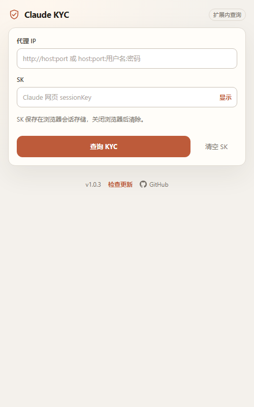

# Claude KYC Extension

[简体中文](README.md) | [English](README.en.md)

Check Claude KYC status from Chrome's side panel with a Claude web session key and an optional proxy.



> Not affiliated with Anthropic, Claude, or Persona. Use only with accounts you are authorized to access.

## Features

- No installer, native helper, backend, or local server
- Chrome Side Panel UI that stays open during verification
- Single and batch SK queries, batch concurrency fixed at 1
- Automatic organization discovery with manual selection when needed
- Verification link, status refresh, and retry actions
- Batch results table with `.xlsx` export
- HTTP and SOCKS5 proxies with optional authentication
- `{session}` and `{region}` proxy placeholders
- Daily GitHub Release update check

## Requirements

- Chrome 148+ or a compatible Chromium browser
- Claude web `sessionKey` (not an Anthropic API key)
- Optional proxy

## Install

1. Download and extract the latest ZIP from [Releases](https://github.com/DouDOU-start/claude-kyc-extension/releases).
2. Open `chrome://extensions` and enable Developer mode.
3. Click **Load unpacked** and select the extracted folder.

To run from source, select the `extension` folder in this repository. Chrome does not install a ZIP by drag-and-drop.

## Usage

Open the side panel from the toolbar, then enter a proxy and SK.

**Single query**

1. Click **查询 KYC** / **Check KYC**.
2. Request the official Persona link when needed.
3. Complete verification, then click **刷新状态** / **Refresh status**.

**Batch query**

1. Open **批量查询** / **Batch**, then enter one SK per line.
2. Click **开始验证** / **Start** and watch the results table.
3. Click **导出 Excel** / **Export Excel** to download the workbook.

Batch mode checks status only. Use single mode to request verification links. Exported SKs are masked.

## Proxy formats

```text
http://host:port
socks5://host:port
host:port
host:port:username:secret
```

Authenticated HTTP and SOCKS5 proxies are supported. The proxy is applied only to `claude.ai` during the request and restored afterward.

## Updates

GitHub-installed copies check for a new release once per day and show a download button. Chromium does not allow a sideloaded extension to update itself silently; download the new version, overwrite the folder, and click **Reload**.

Chrome Web Store distribution provides automatic updates.

## Permissions

- `proxy`: route Claude requests through the configured proxy.
- `webRequest` / `webRequestAuthProvider`: provide optional proxy authentication.
- `declarativeNetRequestWithHostAccess`: inject the SK into one request without modifying browser cookies.
- `sidePanel` / `storage` / `clipboardWrite`: side panel UI, state, and verification-link copying.
- `host_permissions`: access only `claude.ai` and the GitHub Releases API.

## Privacy and security

- The SK is held only in side-panel memory and cleared when the side panel closes.
- Existing Claude cookies are not read or overwritten.
- No telemetry, analytics, or project backend.
- Verification links must use HTTPS and are never opened automatically.

See [PRIVACY.md](PRIVACY.md) and [SECURITY.md](SECURITY.md).

## Development

No build step. Load the `extension` folder and click **Reload** after changes.

```sh
node --test tests/*.test.js
```

GitHub Actions publishes a release when a `v*` tag matches the version in `extension/manifest.json`.

## License

[MIT](LICENSE)
