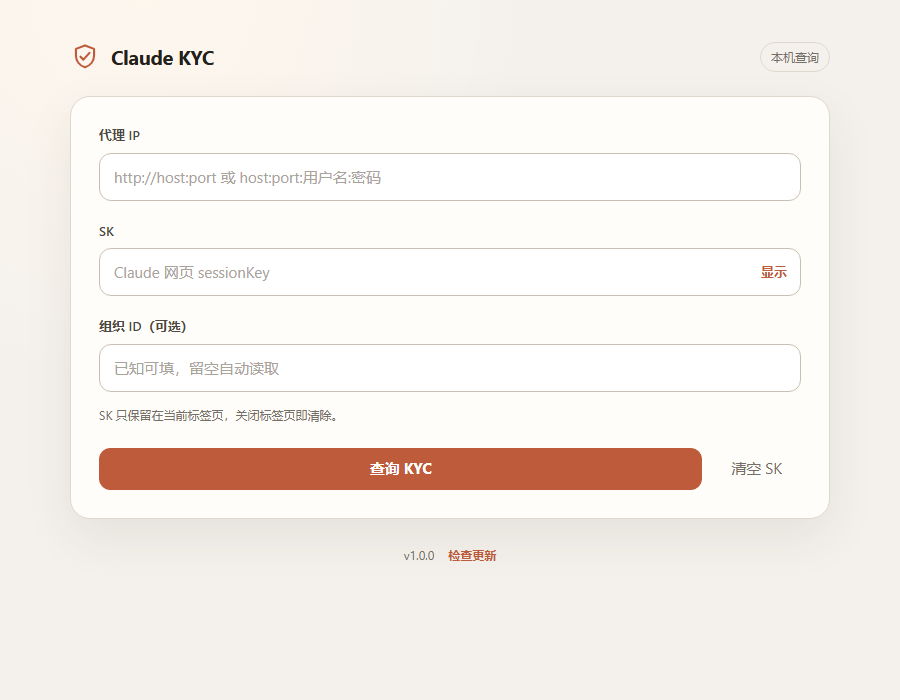

# Claude KYC Extension

A Windows browser extension for checking Claude account KYC status with a Claude web session key and an HTTP, HTTPS, SOCKS5, or SOCKS5H proxy.

[中文说明](README.zh-CN.md)



> This is an independent open-source tool. It is not affiliated with Anthropic, Claude, Persona, Google, or Microsoft. Use it only with accounts and proxies you are authorized to access.

## Features

- Check Claude KYC status without creating or saving an internal account.
- Optional organization ID; when omitted, organizations are discovered from the session key.
- Explicit actions for refreshing the vendor verification link and retrying verification.
- HTTPS-only vendor link validation and a 60-second temporary link window.
- Chrome-compatible TLS/HTTP fingerprinting through a small local Go helper.
- Proxies with optional authentication, including `{session}` and `{region}` templates.
- Automatic update checks against GitHub Releases with SHA-256 verification.
- No project server, telemetry, or analytics.

## Why a native helper?

Chrome extensions cannot reliably reproduce the request fingerprint required by Claude, and Manifest V3 extensions cannot safely handle every authenticated proxy configuration. The browser extension therefore talks to a local native-messaging helper over Chrome's private stdio channel. The helper is started on demand and does not open a local port.

The extension itself remains the UI and state owner. The helper only performs the Claude request, exits, and never stores the session key.

## Requirements

- Windows 10 or Windows 11
- Chrome, Edge, Brave, or another Chromium browser with native messaging support
- A Claude web `sessionKey` (not an Anthropic API key)
- Optional proxy

## Install from GitHub Releases

1. Open the [Releases](https://github.com/DouDOU-start/claude-kyc-extension/releases) page.
2. Download the latest `claude-kyc-extension-vX.Y.Z.zip`.
3. Extract the archive.
4. Double-click `安装.cmd` (`Install.cmd` on non-Chinese Windows).
5. Open `chrome://extensions` or `edge://extensions`.
6. Enable **Developer mode**.
7. Click **Load unpacked** and select:

   ```text
   %LOCALAPPDATA%\ClaudeKYC\extension
   ```

Do not select `%LOCALAPPDATA%\ClaudeKYC` itself. Chrome needs `manifest.json` directly inside the selected folder.

Chrome does not allow normal sideloaded extensions to install themselves silently. The first installation therefore needs these steps. Subsequent versions are checked and installed through the bundled updater.

## Publishing this repository

The default configuration expects a public repository named:

```text
https://github.com/DouDOU-start/claude-kyc-extension
```

Create that public repository and push this project, or change the repository in `project.json` and `extension/manifest.template.json` before building. The GitHub repository must be public for the unauthenticated updater check.

Create a release tag matching the extension version, for example:

```powershell
git tag -a v1.0.0 -m "v1.0.0"
git push origin v1.0.0
```

The included release workflow publishes the ZIP and `SHA256SUMS.txt`. See [docs/RELEASE.md](docs/RELEASE.md).

Pushing a tag such as `v1.0.1` automatically:

- runs all tests;
- builds `kyc-host.exe`, `kyc-updater.exe`, and the extension package on `windows-latest`;
- creates the GitHub Release;
- uploads the update ZIP and SHA-256 checksum file.

## Usage

1. Click the Claude KYC toolbar button.
2. Enter a proxy. Leave it empty for a direct connection.
3. Enter the Claude web `sessionKey`.
4. Optionally enter an organization ID. If omitted, the extension lists organizations visible to the session.
5. Click **查询 KYC** / **Check KYC**.
6. Use **获取验证链接** to request an official Persona link.
7. Complete verification in the browser, then return and click **刷新状态**.

### Proxy formats

```text
http://host:port
https://host:port
socks5://host:port
socks5h://host:port
host:port
host:port:username:credential
```

Rotating proxies may contain `{session}` and `{region}` placeholders. They are resolved for every request.

## Automatic updates

When the extension is loaded from the installed folder:

1. The extension checks the latest GitHub Release at most once per day.
2. A newer version shows an update banner.
3. One click downloads the release, verifies its SHA-256 value, updates the extension and native helper, and reloads the extension.

The updater only accepts release assets from the configured GitHub repository. The release must contain:

- `claude-kyc-extension-vX.Y.Z.zip`
- `SHA256SUMS.txt`

The release page and update server are not contacted with the session key or proxy.

### Chrome Web Store

Publishing to the Chrome Web Store would remove the initial “Load unpacked” step and let Chrome update the extension automatically. This repository can be used as the extension source, but the native helper still needs a Windows installer. The current GitHub release package is the fully self-contained distribution.

See [docs/CHROME_WEB_STORE.md](docs/CHROME_WEB_STORE.md) for permission and packaging notes.

## Privacy and security

- The session key is held in the extension page's `sessionStorage`; closing the tab clears it.
- The proxy is stored in the extension's local browser storage.
- The session key is sent only to `claude.ai` through the chosen proxy.
- The helper does not persist the session key or proxy.
- The project has no backend, telemetry, or analytics.
- Verification links are accepted only over HTTPS and are never opened automatically.

See [PRIVACY.md](PRIVACY.md) and [SECURITY.md](SECURITY.md).

## Build from source

Requirements:

- Go 1.27+
- Node.js 20+
- Windows PowerShell 5.1 or PowerShell 7

```powershell
git clone https://github.com/DouDOU-start/claude-kyc-extension.git
cd claude-kyc-extension
powershell -ExecutionPolicy Bypass -File .\scripts\build.ps1
```

Outputs:

```text
dist\ClaudeKYC\
dist\claude-kyc-extension-v1.0.0.zip
dist\SHA256SUMS.txt
```

## Tests

```powershell
cd extension
node --test tests/*.test.js
cd ..
go test ./...
go vet ./...
```

The test suite covers request validation, session handling, authenticated proxy tunneling, KYC response parsing, terminal status handling, native-message framing, update metadata, SHA-256 verification, ZIP traversal protection, and extension update installation.

## Project layout

```text
cmd/kyc-host/          Native messaging host
cmd/kyc-updater/       Post-exit helper updater
internal/kyc/          Claude KYC HTTP client
internal/proxy/        HTTP/SOCKS proxy implementation
internal/update/       GitHub release update engine
extension/             Manifest V3 browser extension
packaging/             Installer and user quick-start files
scripts/               Build and icon scripts
keys/                  Public extension key and stable ID
docs/                  Architecture and release documentation
```

## Limitations

- Windows only. macOS and Linux installers are not provided yet.
- Claude endpoints used by this project are web endpoints and may change without notice.
- A browser challenge or rate limit is reported as an error, never as a successful KYC result.
- The tool queries status and returns the official vendor link; it does not automate or bypass identity verification.

## Contributing

See [CONTRIBUTING.md](CONTRIBUTING.md). Please do not open public issues for active security vulnerabilities; use [SECURITY.md](SECURITY.md).

## License

[MIT](LICENSE)
