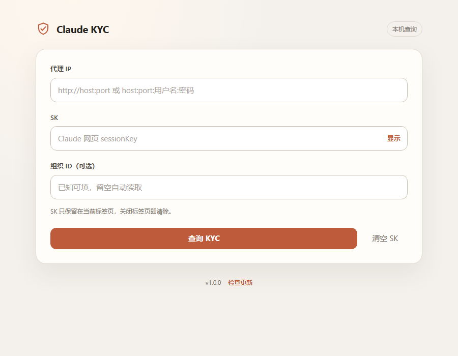

# Claude KYC 浏览器扩展

在 Windows 上的 Chromium 浏览器中，用 Claude 网页 SK 和代理查询账号 KYC 状态。

[English](README.md)



> 本项目是独立开源工具，与 Anthropic、Claude、Persona、Google、Microsoft 均无隶属关系。请仅用于你有权访问的账号和代理。

## 功能

- 无需创建内部账号，直接查询 Claude KYC 状态。
- 组织 ID 可选；不填时通过 SK 自动读取组织列表。
- 可明确刷新验证链接、重新验证，不会自动轮询或自动提交。
- 验证链接仅接受 HTTPS，约 60 秒后失效。
- 通过本机 Go 查询器保留 Chrome TLS/HTTP 指纹能力。
- 支持 HTTP、HTTPS、SOCKS5、SOCKS5H 代理及认证。
- 支持 `{session}`、`{region}` 动态代理模板。
- 每天自动检查 GitHub Releases，下载后校验 SHA-256。
- 无项目服务器、无遥测、无统计。

## 为什么需要本机组件

普通 Manifest V3 扩展无法稳定复现 Claude 需要的 Chrome 指纹，也无法可靠处理所有带认证的代理。扩展通过 Chrome Native Messaging 调用一个按需启动的本地查询器；查询器不开放端口，不保存 SK。

## 系统要求

- Windows 10/11
- Chrome、Edge、Brave 等支持 Native Messaging 的 Chromium 浏览器
- Claude 网页 `sessionKey`，不是 Anthropic API Key
- 代理可选

## 从 GitHub 安装

1. 打开 [Releases](https://github.com/DouDOU-start/claude-kyc-extension/releases)。
2. 下载最新的 `claude-kyc-extension-vX.Y.Z.zip`。
3. 解压整个安装包。
4. 双击 `安装.cmd`。
5. 打开 `chrome://extensions` 或 `edge://extensions`。
6. 开启“开发者模式”。
7. 点击“加载已解压的扩展程序”，选择：

   ```text
   %LOCALAPPDATA%\ClaudeKYC\extension
   ```

不要选择上一级 `%LOCALAPPDATA%\ClaudeKYC`。Chrome 要求 `manifest.json` 直接位于所选目录。

Chrome 不允许普通 sideload 扩展静默安装自己，所以首次需要以上步骤。之后的新版本由安装包内的更新器自动检查和安装。

## 发布到 GitHub

项目默认配置对应一个公开仓库：

```text
https://github.com/DouDOU-start/claude-kyc-extension
```

请创建这个公开仓库并推送本项目；如果使用其他仓库名，请同时修改 `project.json` 和 `extension/manifest.template.json` 后重新构建。自动更新使用未认证的 GitHub API，仓库必须公开。

创建与扩展版本一致的 Release 标签：

```powershell
git tag -a v1.0.0 -m "v1.0.0"
git push origin v1.0.0
```

仓库内的 Release Workflow 会自动上传 ZIP 和 `SHA256SUMS.txt`。详见 [docs/RELEASE.md](docs/RELEASE.md)。

推送 `v1.0.1` 这样的标签后，GitHub Actions 会自动：

- 运行全部测试；
- 在 `windows-latest` 上构建查询器、更新器和扩展包；
- 创建 GitHub Release；
- 上传更新 ZIP 和 SHA-256 校验文件。

## 使用

1. 点击工具栏中的 Claude KYC。
2. 填写代理，留空则直连。
3. 填写 Claude 网页 SK。
4. 可填写组织 ID；留空时自动读取组织。
5. 点击“查询 KYC”。
6. 点击“获取验证链接”取得 Persona 官方验证地址。
7. 在浏览器中完成验证后，回到扩展点击“刷新状态”。

### 代理格式

```text
http://主机:端口
https://主机:端口
socks5://主机:端口
socks5h://主机:端口
主机:端口
主机:端口:用户名:密码
```

代理可包含 `{session}` 和 `{region}`，每次请求自动替换。

## 自动更新

扩展从安装器目录加载后：

1. 每天最多自动查询一次 GitHub 最新 Release。
2. 有新版本时显示更新提示。
3. 点击一次即可下载、校验 SHA-256、更新扩展和本机查询器，并重新加载扩展。

更新器只接受配置仓库中的 Release 资产：

- `claude-kyc-extension-vX.Y.Z.zip`
- `SHA256SUMS.txt`

SK 和代理不会发送到 GitHub。

### 关于 Chrome Web Store

如果上架 Chrome Web Store，首次安装可以做到一键完成，扩展本体也能由商店自动更新。但本机查询器仍需要 Windows 安装器。当前 GitHub Release 包是完整、自包含的发布方式。

权限和打包说明见 [docs/CHROME_WEB_STORE.md](docs/CHROME_WEB_STORE.md)。

## 隐私与安全

- SK 只保存在当前扩展页面的 `sessionStorage`，关闭标签页即清除。
- 代理地址保存在扩展本地存储。
- SK 仅通过所选代理发送给 `claude.ai`。
- 本机查询器不持久化 SK 或代理。
- 无后端、无遥测、无统计。
- 验证链接仅接受 HTTPS，不自动打开。

详见 [PRIVACY.md](PRIVACY.md) 和 [SECURITY.md](SECURITY.md)。

## 从源码构建

需要：

- Go 1.27+
- Node.js 20+
- Windows PowerShell 5.1 或 PowerShell 7

```powershell
git clone https://github.com/DouDOU-start/claude-kyc-extension.git
cd claude-kyc-extension
powershell -ExecutionPolicy Bypass -File .\scripts\build.ps1
```

输出：

```text
dist\ClaudeKYC\
dist\claude-kyc-extension-v1.0.0.zip
dist\SHA256SUMS.txt
```

## 测试

```powershell
cd extension
node --test tests/*.test.js
cd ..
go test ./...
go vet ./...
```

## 目录结构

```text
cmd/kyc-host/          Native Messaging 查询器
cmd/kyc-updater/       进程退出后的文件更新器
internal/kyc/          Claude KYC HTTP 客户端
internal/proxy/        HTTP/SOCKS 代理
internal/update/       GitHub Release 更新逻辑
extension/             Manifest V3 扩展
packaging/             安装器和快速说明
scripts/               构建与图标脚本
keys/                  扩展公钥和固定 ID
docs/                  架构与发布文档
```

## 限制

- 仅提供 Windows 安装器。
- 使用的是 Claude 网页接口，接口变化可能导致功能失效。
- 浏览器验证、限流、401/403 会显示为错误，不会误报为验证成功。
- 本工具只查询状态并提供官方验证链接，不自动完成或绕过实名验证。

## 贡献

请阅读 [CONTRIBUTING.md](CONTRIBUTING.md)。安全漏洞请按 [SECURITY.md](SECURITY.md) 私下报告。

## 许可证

[MIT](LICENSE)
